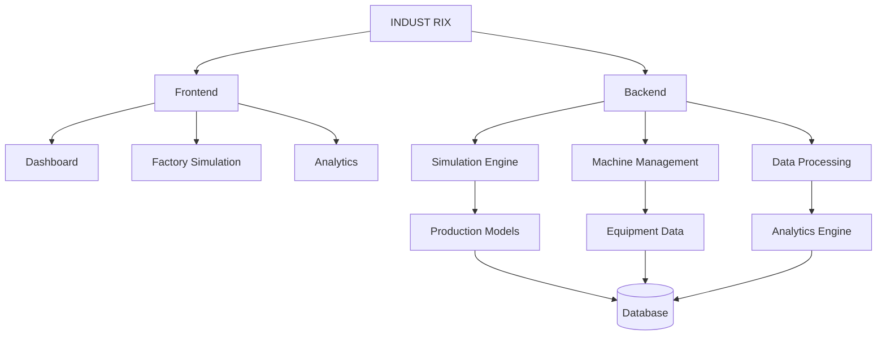

### ПЛАТФОРМА ПРОМЫШЛЕННОГО МОДЕЛИРОВАНИЯ И АНАЛИТИКИ

**Моделируй. Анализируй. Оптимизируй.**

Цифровая платформа для моделирования, мониторинга и повышения эффективности промышленных предприятий.

 

---

## ◈ О проекте

**Industrix** — разрабатываемая интеллектуальная платформа для цифрового моделирования промышленных предприятий.

Проект направлен на создание виртуальных моделей производств, позволяющих наблюдать за технологическими процессами, контролировать состояние оборудования, анализировать показатели и проверять различные производственные сценарии.

Главная задача — предоставить возможность исследовать работу предприятия и оценивать последствия принимаемых решений без вмешательства в реальные производственные процессы.

### Основная идея

> Время — универсальный ресурс. Его сохранение и рациональное использование — одна из важнейших задач современной промышленности.

---

## ◈ Основные возможности

В рамках проекта планируется реализовать следующие модули:

<table>
<tr>
<td width="50%">

### 📊 Dashboard

Главная панель предприятия с основными показателями производства, состоянием оборудования и текущими событиями.

</td>
<td width="50%">

### 🏭 Factory Simulation

Виртуальная модель производства с взаимосвязанным оборудованием и производственными процессами.

</td>
</tr>
<tr>
<td width="50%">

### ⚙️ Machine Management

Управление виртуальным оборудованием, просмотр характеристик и контроль технического состояния.

</td>
<td width="50%">

### 📈 Analytics

Интерактивные графики, производственная статистика и анализ эффективности предприятия.

</td>
</tr>
<tr>
<td width="50%">

### 🧠 Predictive Maintenance

Анализ состояния оборудования, обнаружение аномалий и прогнозирование потенциальных неисправностей.

</td>
<td width="50%">

### 🔬 What If? Simulator

Моделирование альтернативных производственных сценариев и анализ их последствий.

</td>
</tr>
</table>

---

## ◈ Архитектура системы

Industrix проектируется на основе модульной архитектуры. Каждый компонент будет отвечать за определённую область работы платформы.

Центральным элементом системы станет **Simulation Engine** — вычислительный модуль, отвечающий за моделирование производственных процессов и взаимодействия оборудования.

---

## ◈ Технологический стек

Предполагаемые технологии разработки:

### Backend

### Frontend

### Data & Infrastructure

| Технология | Назначение |
|:---|:---|
| Python | Основная логика приложения |
| FastAPI | Серверная часть и API |
| React | Пользовательский интерфейс |
| TypeScript | Разработка интерфейса |
| NumPy | Математические расчёты |
| Pandas | Обработка данных |
| Plotly | Интерактивная визуализация |
| PostgreSQL | Хранение данных |
| SQLAlchemy | Взаимодействие с базой данных |

---

## ◈ Дорожная карта разработки

Разработка Industrix будет проходить поэтапно.

- [ ] **Этап 01 — Фундамент**
  - [ ] Проектирование архитектуры
  - [ ] Создание Backend
  - [ ] Создание Frontend
  - [ ] Настройка взаимодействия через API

- [ ] **Этап 02 — Интерфейс**
  - [ ] Главная панель Dashboard
  - [ ] Система навигации
  - [ ] Адаптация под мобильные устройства

- [ ] **Этап 03 — Моделирование**
  - [ ] Разработка Simulation Engine
  - [ ] Создание виртуального оборудования
  - [ ] Производственные линии
  - [ ] Расчёт производительности

- [ ] **Этап 04 — Аналитика**
  - [ ] Производственные показатели
  - [ ] Интерактивные графики
  - [ ] История производства
  - [ ] Анализ эффективности

- [ ] **Этап 05 — Интеллектуальные функции**
  - [ ] Обнаружение аномалий
  - [ ] Прогнозирование неисправностей
  - [ ] What If? Simulator
  - [ ] Алгоритмы оптимизации

- [ ] **Этап 06 — Развитие платформы**
  - [ ] Пользовательские аккаунты
  - [ ] Создание собственных предприятий
  - [ ] Интеграция реальных производственных данных
  - [ ] Корпоративные возможности

---

## ◈ Принципы разработки

В основе Industrix лежат несколько принципов:

- **Точность** — расчёты должны основываться на понятных математических моделях.
- **Модульность** — каждый компонент должен быть независимым и удобным для развития.
- **Масштабируемость** — архитектура должна позволять расширять возможности платформы.
- **Прозрачность** — виртуальные данные нельзя выдавать за реальные промышленные измерения.
- **Практичность** — каждая функция должна решать конкретную задачу.

---

## ◈ Перспективы развития

В долгосрочной перспективе Industrix должен превратиться в полноценную платформу цифровых двойников промышленных предприятий.

Пользователи смогут создавать виртуальные производственные среды, проверять различные инженерные решения, анализировать работу оборудования и оценивать последствия изменений ещё до их внедрения на реальном предприятии.

**Не просто мониторинг. Не просто аналитика. Новый подход к пониманию промышленного производства.**

---

### INDUST RIX

**Моделируй. Анализируй. Оптимизируй.**

Создаём будущее промышленной аналитики.

  

