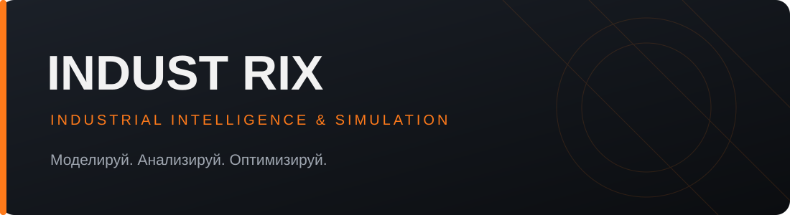
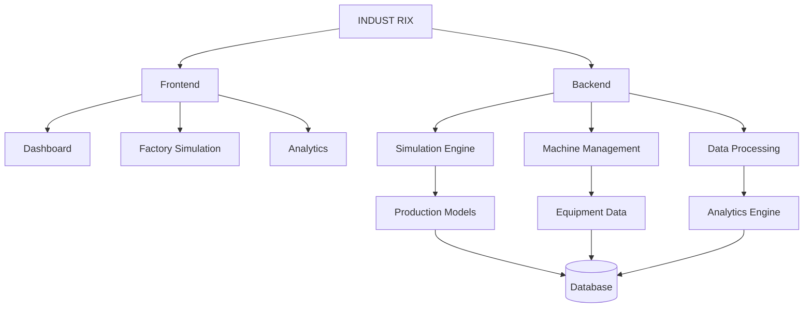

  

### ПЛАТФОРМА ПРОМЫШЛЕННОГО МОДЕЛИРОВАНИЯ И АНАЛИТИКИ

**Моделируй. Анализируй. Оптимизируй.**

 

 

<table>
<tr>
<td bgcolor="#111820" style="border: 1px solid #263642; border-radius: 10px; padding: 22px;">

## ◈ О ПРОЕКТЕ

**Industrix** — интеллектуальная платформа для цифрового моделирования промышленных предприятий.

Проект направлен на создание виртуальных моделей производств, позволяющих наблюдать за технологическими процессами, контролировать состояние оборудования, анализировать показатели и проверять различные производственные сценарии.

Главная задача — предоставить возможность исследовать работу предприятия и оценивать последствия принимаемых решений без вмешательства в реальные производственные процессы.

 

**ОСНОВНАЯ ИДЕЯ**

> Время — универсальный ресурс. Его сохранение и рациональное использование — одна из важнейших задач современной промышленности.

</td>
</tr>
</table>

 

## ◈ ОСНОВНЫЕ ВОЗМОЖНОСТИ

<table>
<tr>
<td width="50%" bgcolor="#111820">

### 📊 Dashboard

Главная панель предприятия с основными показателями производства, состоянием оборудования и текущими событиями.

</td>
<td width="50%" bgcolor="#111820">

### 🏭 Factory Simulation

Виртуальная модель производства с взаимосвязанным оборудованием и производственными процессами.

</td>
</tr>
<tr>
<td width="50%" bgcolor="#111820">

### ⚙️ Machine Management

Управление виртуальным оборудованием, просмотр характеристик и контроль технического состояния.

</td>
<td width="50%" bgcolor="#111820">

### 📈 Analytics

Интерактивные графики, производственная статистика и анализ эффективности предприятия.

</td>
</tr>
<tr>
<td width="50%" bgcolor="#111820">

### 🧠 Predictive Maintenance

Анализ состояния оборудования, обнаружение аномалий и прогнозирование потенциальных неисправностей.

</td>
<td width="50%" bgcolor="#111820">

### 🔬 What If? Simulator

Моделирование альтернативных производственных сценариев и анализ их последствий.

</td>
</tr>
</table>

 

<table>
<tr>
<td bgcolor="#111820" style="padding: 22px;">

## ◈ АРХИТЕКТУРА СИСТЕМЫ

Industrix проектируется на основе модульной архитектуры. Каждый компонент будет отвечать за определённую область работы платформы.

Центральным элементом системы станет **Simulation Engine** — вычислительный модуль, отвечающий за моделирование производственных процессов и взаимодействия оборудования.

</td>
</tr>
</table>

 

<table>
<tr>
<td bgcolor="#111820" style="padding: 22px;">

## ◈ ТЕХНОЛОГИЧЕСКИЙ СТЕК

**BACKEND**

**FRONTEND**

**DATA & INFRASTRUCTURE**

| Технология | Назначение |
|:---|:---|
| Python | Основная логика приложения |
| FastAPI | Серверная часть и API |
| React | Пользовательский интерфейс |
| TypeScript | Разработка интерфейса |
| NumPy | Математические расчёты |
| Pandas | Обработка данных |
| Plotly | Интерактивная визуализация |
| PostgreSQL | Хранение данных |
| SQLAlchemy | Работа с базой данных |

</td>
</tr>
</table>

 

<table>
<tr>
<td bgcolor="#111820" style="padding: 22px;">

## ◈ ДОРОЖНАЯ КАРТА

- [ ] **Этап 01 — Фундамент**
  - [ ] Проектирование архитектуры
  - [ ] Создание Backend
  - [ ] Создание Frontend
  - [ ] Настройка API

- [ ] **Этап 02 — Интерфейс**
  - [ ] Dashboard
  - [ ] Система навигации
  - [ ] Адаптация под мобильные устройства

- [ ] **Этап 03 — Моделирование**
  - [ ] Simulation Engine
  - [ ] Виртуальное оборудование
  - [ ] Производственные линии
  - [ ] Расчёт производительности

- [ ] **Этап 04 — Аналитика**
  - [ ] Производственные показатели
  - [ ] Интерактивные графики
  - [ ] История производства
  - [ ] Анализ эффективности

- [ ] **Этап 05 — Интеллектуальные функции**
  - [ ] Обнаружение аномалий
  - [ ] Прогнозирование неисправностей
  - [ ] What If? Simulator
  - [ ] Оптимизация процессов

- [ ] **Этап 06 — Развитие платформы**
  - [ ] Пользовательские аккаунты
  - [ ] Собственные предприятия
  - [ ] Интеграция реальных данных
  - [ ] Корпоративные возможности

</td>
</tr>
</table>

 

<table>
<tr>
<td bgcolor="#111820" style="padding: 22px;">

## ◈ ПРИНЦИПЫ РАЗРАБОТКИ

- **Точность** — расчёты основаны на понятных математических моделях.
- **Модульность** — компоненты независимы и удобны для развития.
- **Масштабируемость** — архитектура предусматривает расширение платформы.
- **Прозрачность** — виртуальные данные не выдаются за реальные измерения.
- **Практичность** — каждая функция решает конкретную задачу.

</td>
</tr>
</table>

 

<table>
<tr>
<td bgcolor="#111820" style="padding: 22px;">

## ◈ ПЕРСПЕКТИВЫ РАЗВИТИЯ

В долгосрочной перспективе Industrix должен превратиться в полноценную платформу цифровых двойников промышленных предприятий.

Пользователи смогут создавать виртуальные производственные среды, проверять инженерные решения, анализировать работу оборудования и оценивать последствия изменений до их внедрения на реальном предприятии.

**Не просто мониторинг. Не просто аналитика. Новый подход к пониманию промышленного производства.**

</td>
</tr>
</table>

 

# INDUST RIX

**Моделируй. Анализируй. Оптимизируй.**

Создаём будущее промышленной аналитики.

  

